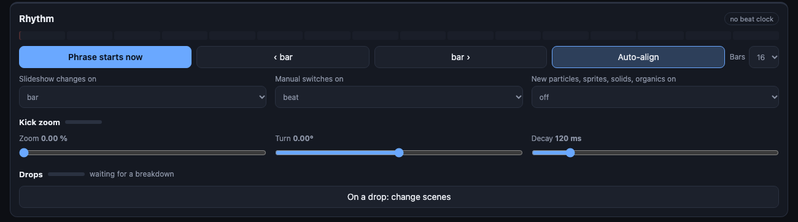
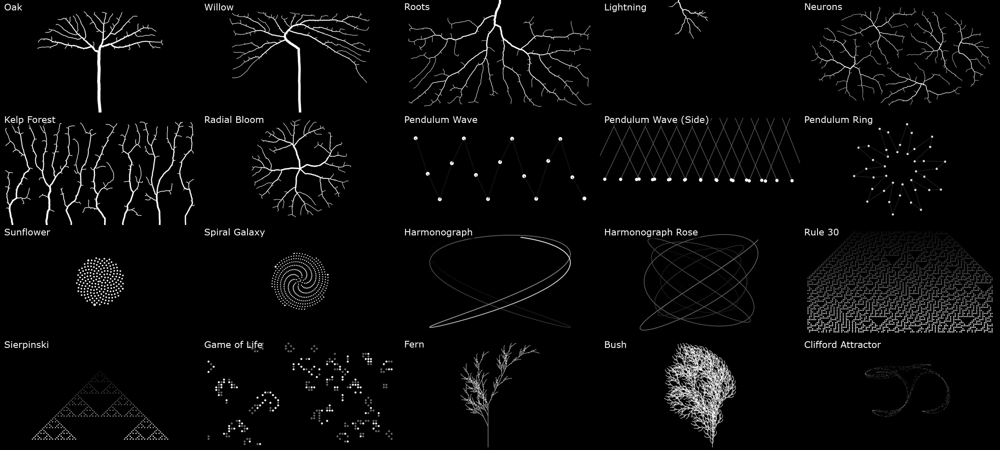
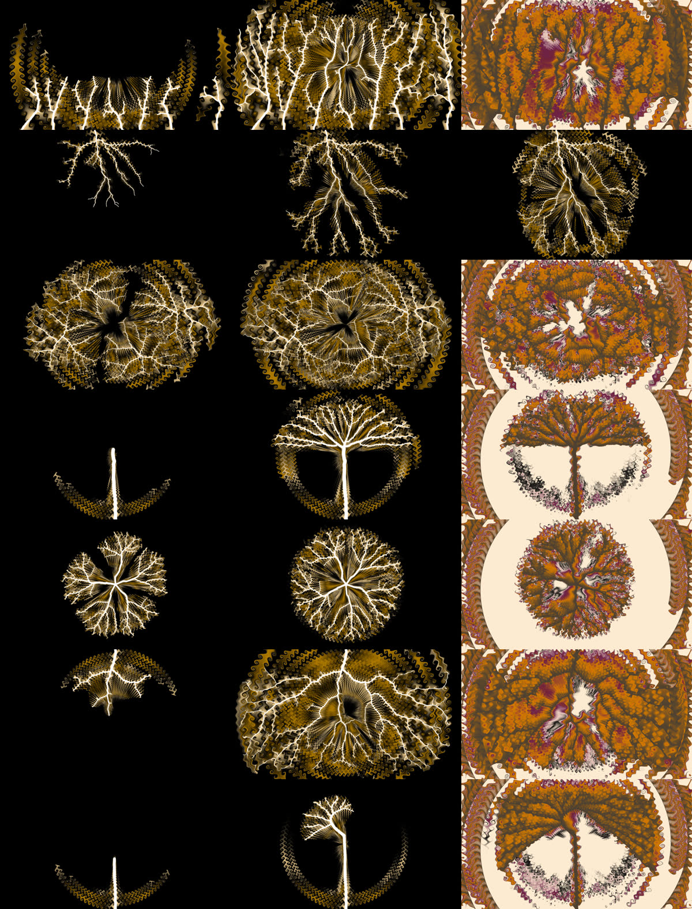
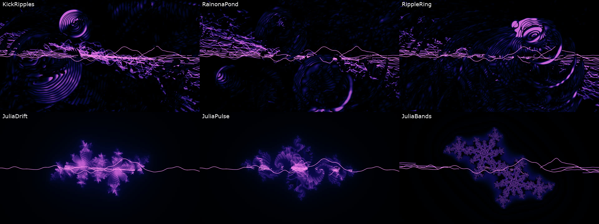

# Prototypes to try (built 2026-11-17 while you were away; water, fractals and groups 2026-11-18)

Everything below is installed in /Applications/reforce.app (relaunch reforce to get it) and none of it is committed.
Nothing changes what you see until you turn it on: the new settings default to off, and the new organics only appear
when you start one.

## 1. Rhythm section (control panel, below the layer cards)

| Control | What to try | Default |
|---|---|---|
| Phrase strip | Watch it with rekordbox (Link) playing: the lit cell is the bar of the phrase. The chip says where the phrase lines come from: *guessing* (Link bar 1), *auto · N % sure*, or *set by hand*. | 16 bars |
| Phrase starts now | Tap it on the "one" of a phrase (a drop, the start of a breakdown). ‹ bar / bar › move the phrase by a bar. | |
| Auto-align | Finds phrase lines from loudness changes over a few phrases. On the test track it settled after ~2 minutes; it has not been checked against real phrase boundaries yet. | on |
| Slideshow changes on → **phrase** | FlowField / WaveShape / ColorMap changes wait for the next phrase line: the slideshow follows the song's structure. | bar |
| New … on → **phrase** | Slideshow particles, sprites, solids and organics wait for the next phrase line too. | off |
| Kick zoom | Try Zoom 0.5–1.5 %, Turn ±0.3°, Decay 120 ms: the trails surge outward on every beat. | 0 (off) |
| Drops | Shows *breakdown · build N %* and *drop!*. **On a drop: change scenes** cuts FlowField, WaveShape and ColorMap on the drop. Tuned on one track only. | off |

Scenes can use the new variables `SYNC_BAR`, `SYNC_PHRASE` (phrase count; `wrap()` = position in the phrase),
`SYNC_BUILD` (0..1 through a breakdown) and `SYNC_DROP` (1 at a drop, fading over a bar).

## 2. Organics: 13 new configs (Organics card, or the Organics theme)

The overview below shows each organic alone on black (no FlowField, no WaveShape), about 22 s in. In a real scene they
trail through the FlowField and take the ColorMap.

| Config | Kind | What it does with the beat |
|---|---|---|
| Pendulum Wave | pendulums | 15 bobs; the first swings once per bar, the rest a little faster each, so they drift apart and line up again on every phrase line |
| Pendulum Wave (Side) | pendulums | 24 pendulums on strings from the top; lined up every 8 bars |
| Pendulum Ring | pendulums | 40 bobs on a ring swinging in and out: flowers and stars; pulses on the beat |
| Sunflower | phyllotaxis | a seed every 16th note at the golden angle |
| Spiral Galaxy | phyllotaxis | its angle sweeps once per phrase, so the spiral arms wind up and fly apart |
| Harmonograph / Rose | harmonograph | Lissajous figures in cycles per bar: they close on the bar |
| Rule 30 / Sierpinski | automaton | a cellular-automaton row per 8th / per beat, scrolling up |
| Game of Life | life | a generation per beat, a fresh soup on every phrase line |
| Fern / Bush | lsystem | a generation every 2 / 1 bars, traced in over the bar |
| Clifford Attractor | attractor | a strange attractor whose shape glides over 24–40 bars |

The seven trees from earlier (Oak … Radial Bloom) are unchanged. In a scene:

## 3. New on 2026-11-18: water, fractals, groups

| Config | Group | What it does with the beat |
|---|---|---|
| Ripples Kick | Water | a stone dropped in still water on every beat, at a random spot; the rings spread and run off the frame |
| Ripples Pond | Water | light rain and a big drop on every bar; the edges reflect; the rain thickens through a breakdown |
| Ripples Ring | Water | drops on the 8th notes stepping round a ring every 2 bars, so the rings chase each other |
| Julia Drift | Fractals | c travels once per phrase along the Mandelbrot set's edge: cauliflower, spirals, snowflakes |
| Julia Pulse | Fractals | the "San Marco" set, swelling on every beat |
| Julia Bands | Fractals | a spiral set drawn as bands that flow inward once per beat |

These draw on the GPU (about 1 ms a frame), into their own texture, and trail like the rest.

**Groups:** the Objects card's library now lists every organic under its group (Trees, Pendulums, Spirals, Curves,
Cells, Water, Fractals). Pick a group in its dropdown to see only that group, and **▶ Play <group>** to switch to
that group's theme (`Organics: Water` ...): the slideshow then grows only that group, one every ~30 s. Press it again
(✓ Playing ...) to go back to the Organics theme. The group themes are also in the Theme menu at the top.

## 4. Decided (2026-11-18)

- Defaults stay: slideshow changes on the bar, kick zoom off, drop switch off.
- No more drop tuning for now.
- Organics grouped by theme (above); ripples and Julia sets built (above).
- Keep every organic for now.

## Where things are

- Design and tuning notes: [rhythm-design.md](rhythm-design.md) (phrases, kick zoom, drops, new kinds),
  [organics-design.md](organics-design.md) (trees), keys in [scene-format.md](scene-format.md) §3.5 and §5.8.
- Code: `src/sync/PhraseClock.*`, `src/sync/DropDetector.*`, `src/engine/OrganicKinds.*` (new kinds),
  `src/render/FieldPipeline.*` (ripples, Julia), groups in `content/Categories/Object/` and `content/Themes/`,
  `src/engine/Organics.*` (trees, pendulums), kick zoom in `src/render/ScenePipeline.cpp` (`kick_src`), Rhythm panel in
  `src/web/ui/`.
- Tests: `tests/test_sync_phrase.cpp`, `tests/test_sync_drop.cpp`, `tests/test_engine_organics.cpp`,
  `tests/test_render_fields.cpp`, rhythm and group cases in `tests/test_web_api.cpp`. All 18 suites pass, and G-Force
  parity is unchanged.
- PLAN.md: 5N (organics), 5O (rhythm, 5O.6 GPU kinds, 5O.7 groups), "Waiting on Peter" items 13-15.
